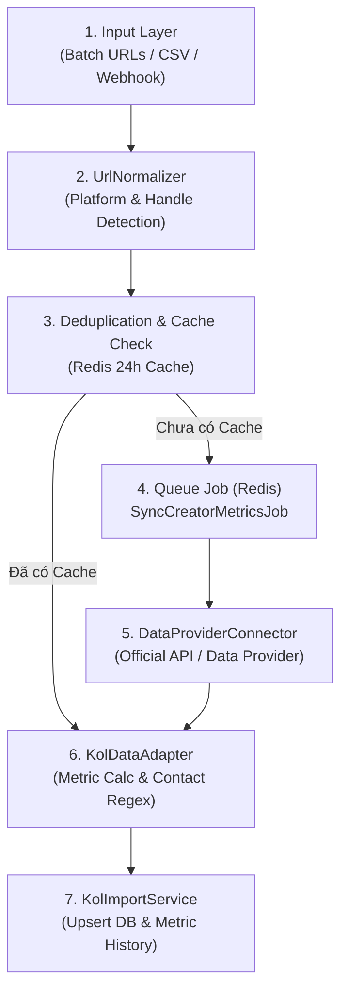
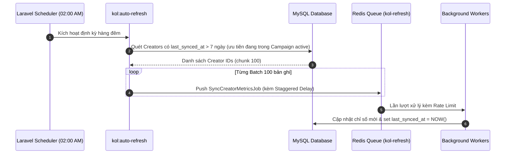

# Quy Chuẩn Tự Động Hóa Đồng Bộ Dữ Liệu KOL/KOC Đa Nền Tảng (Automated API & Data Provider Pipeline)

Tài liệu này là quy chuẩn kỹ thuật bắt buộc cho toàn bộ tiến trình tự động hóa 100% việc thu thập, chuẩn hóa, phân tích chỉ số và định kỳ làm mới dữ liệu KOL/KOC trên các nền tảng (TikTok, YouTube, Facebook, Instagram, Shopee) trong hệ thống Booking KOL.

---

## 1. Triết Lý & Định Hướng Nguyên Tắc (Core Principles)

Để đảm bảo hiệu quả vận hành tối đa mà vẫn giữ cho hạ tầng máy chủ ổn định và an toàn, hệ thống vận hành theo 3 nguyên tắc bất biến:

### 1.1. Tự Động Hóa Không Chạm (Zero-Touch Automation)
- **Giải phóng thao tác thủ công:** Người dùng (Marketer / Booking Executive) chỉ cần dán một danh sách URL (Batch URLs), tải lên file Excel/CSV, hoặc dữ liệu được gửi từ Webhook. Sau bước kích hoạt ban đầu, toàn bộ quá trình xác thực, phân giải tài khoản, gọi dữ liệu, bóc tách chỉ số và ghi cơ sở dữ liệu phải được chạy hoàn toàn tự động trong nền (Background Processing).
- **Phản hồi phi đồng bộ thời gian thực:** Web giao diện không bao giờ đợi kết quả API ngoài theo dạng đồng bộ (synchronous). Mọi tác vụ được chuyển giao cho Hàng đợi (Queue Worker), tiến độ được thông báo qua Event/Poller trạng thái.

### 1.2. Tách Biệt Tầng Thu Thập (Decoupled Data Provider Architecture)
- **Web App là Data Aggregator:** Máy chủ Web chính tuyệt đối không đóng vai trò là bot cào dữ liệu lậu trực tiếp từ giao diện HTML (không chạy headless browser ngốn RAM/CPU trên app server).
- **Kết nối qua RESTful API & Webhooks chuẩn hóa:** Dữ liệu được tiếp nhận từ 2 nguồn an toàn:
  1. **Official Platform APIs:** TikTok Marketing/Creator API, YouTube Data API v3, Meta Graph API (Instagram/Facebook), Shopee Open Platform.
  2. **Specialized 3rd-Party Social Data Providers:** Cổng API từ các nhà cung cấp dữ liệu mạng xã hội chuyên nghiệp (Kalodata API, FastMoss API, Shoplus API, Apify Actors, SocialBlade API, EnsoData, RapidAPI verified connectors).
- **Adapter Pattern:** Tách rời đặc thù định dạng JSON của từng Provider khỏi mô hình thực thể nội bộ của hệ thống thông qua `SocialDataConnectorInterface` và `KolDataAdapter`.

### 1.3. Hàng Rào Bảo Vệ Hạ Tầng Hệ Thống (System Safety Guardrails)
- **Rate Limiting nghiêm ngặt:** Khống chế tần suất gửi request cho từng cổng dữ liệu (Token Bucket / Leaky Bucket qua Redis) để ngăn chặn mã lỗi HTTP `429 Too Many Requests` và bảo vệ chi phí API.
- **Exponential Backoff & Smart Retries:** Khi gặp lỗi tạm thời (Timeout, HTTP 500, 502, 503, 504, 429), tiến trình tự động retry 3 lần với khoảng chờ cấp số nhân kèm độ trễ ngẫu nhiên (`jitter`): 2s, 8s, 32s.
- **Deduplication & Caching 24 giờ:** Dữ liệu profile và video được cache trong Redis với thời hạn 24h theo khóa `kol_raw_cache:{platform}:{normalized_handle}`. Nếu có yêu cầu đồng bộ cùng một Creator trong vòng 24h, hệ thống tái sử dụng cache để tránh gọi trùng lặp tốn hạn ngạch.
- **Phân luồng Hàng Đợi (Queue Isolation):** Các Job đồng bộ mạng xã hội chạy trên queue riêng (`kol-sync` và `kol-refresh`), không tranh chấp tài nguyên với các queue cốt lõi như gửi Email, thông báo Zalo hoặc xuất kho hàng mẫu.

---

## 2. Kiến Trúc Luồng Thực Thi Tự Động (Automated Pipeline Architecture)

Mọi yêu cầu thu thập dữ liệu đi qua đường ống (pipeline) 6 bước chuẩn hóa:



### Chi Tiết Từng Mắt Xích

| Bước | Thành phần | Trách nhiệm chính |
| :--- | :--- | :--- |
| **1** | `Input Layer` | Tiếp nhận danh sách URL từ Web UI (textarea), file Excel/CSV danh sách kênh, hoặc Webhook từ bên thứ ba. Sinh mã theo dõi `batch_id`. |
| **2** | `UrlNormalizer` | Bóc tách URL, loại bỏ các tham số rác (`fbclid`, `utm_*`, `is_from_webapp`), xác định nền tảng (`PlatformEnum`) và chuẩn hóa `@handle` duy nhất. |
| **3** | `Cache Layer` | Kiểm tra xem handle này đã được đồng bộ trong 24h qua chưa. Nếu có, bỏ qua bước gọi Provider bên ngoài. |
| **4** | `Queue Job` | Đẩy `SyncCreatorMetricsJob` vào Redis Queue với cấu hình Rate Limiter và Retry Strategy. |
| **5** | `DataProviderConnector` | Gọi RESTful API hoặc chờ Webhook từ nhà cung cấp dữ liệu mạng xã hội đã chọn. |
| **6** | `KolDataAdapter` | Lọc bài ghim (pinned/top), lấy 15 bài gần nhất, tính toán chỉ số tương tác (Views, Likes, ER%), trích xuất SĐT/Email từ Bio qua Regex. |
| **7** | `KolImportService` | Thực hiện `DB::transaction()` upsert hồ sơ Creator, Creator Account, Rate Card và lưu snapshot lịch sử chỉ số (`creator_metrics_history`). |

---

## 3. Chuẩn Hóa & Bóc Tách Dữ Liệu Tự Động (`KolDataAdapter`)

`KolDataAdapter` chịu trách nhiệm biến đổi dữ liệu thô (raw payload) từ mọi nhà cung cấp thành định dạng chuẩn nghiệp vụ nội bộ.

### 3.1. Quy Tắc Loại Bỏ Bài Đăng Ghim (Pinned Posts Filter)
> [!IMPORTANT]
> **TẠI SAO BẮT BUỘC LOẠI BỎ BÀI GHIM?**
> Các bài đăng ghim (`is_top == 1`, `is_pinned == true`) thường là video viral đột biến từ nhiều tháng/năm trước hoặc video quảng cáo đặc biệt. Nếu tính gộp vào, chỉ số trung bình (Views, Likes, Shares) sẽ bị sai lệch nghiêm trọng so với phong độ thực tế hiện tại của KOL.

- **Thuật toán xử lý:**
  1. Duyệt danh sách bài đăng từ API.
  2. Bỏ qua tất cả các bài có cờ `is_pinned`, `is_top`, `pinned == true`.
  3. Lấy chính xác **15 bài đăng thông thường gần nhất** sắp xếp theo `published_at DESC`.
  4. Nếu số lượng bài sau khi lọc ít hơn 5 bài, lấy tối đa số bài hiện có và gắn cờ `low_sample_warning = true`.

### 3.2. Công Thức Tính Toán Chỉ Số Tương Tác Chuẩn Xác
Áp dụng đối với tập 15 bài đăng gần nhất đã qua bộ lọc:

1. **Lượt xem trung bình (Average Views):**
   $$\overline{\text{Views}} = \frac{1}{N} \sum_{i=1}^{N} \text{Views}_i \quad (N \le 15)$$

2. **Lượt tương tác trung bình (Average Interactions):**
   $$\overline{\text{Likes}} = \frac{1}{N} \sum_{i=1}^{N} \text{Likes}_i, \quad \overline{\text{Comments}} = \frac{1}{N} \sum_{i=1}^{N} \text{Comments}_i, \quad \overline{\text{Shares}} = \frac{1}{N} \sum_{i=1}^{N} \text{Shares}_i$$

3. **Tỷ lệ tương tác chuẩn trên Người theo dõi (Engagement Rate on Followers - $\text{ER}_{\text{Followers}}$):**
   $$\text{ER}_{\text{Followers}} (\%) = \frac{\overline{\text{Likes}} + \overline{\text{Comments}} + \overline{\text{Shares}}}{\text{Followers Count}} \times 100$$

4. **Tỷ lệ tương tác trên Lượt xem (Engagement Rate on Views - $\text{ER}_{\text{Views}}$):**
   $$\text{ER}_{\text{Views}} (\%) = \frac{\overline{\text{Likes}} + \overline{\text{Comments}} + \overline{\text{Shares}}}{\overline{\text{Views}}} \times 100$$

> [!TIP]
> Hệ thống lưu trữ cả hai chỉ số ER: $\text{ER}_{\text{Followers}}$ dùng để đánh giá độ gắn kết của tệp fan cứng, $\text{ER}_{\text{Views}}$ dùng để đánh giá chất lượng thực tế của nội dung khi được thuật toán phân phối.

### 3.3. Tự Động Bóc Tách Liên Hệ Từ Bio Bằng Regex (Contact Extraction)
KOL/KOC thường ghi thông tin liên hệ ngay trong Bio profile (ví dụ: *"Booking: 0912.345.678 - mail: contact@gmail.com"*). `KolDataAdapter` tự động áp dụng Regex bóc tách:

- **Số điện thoại Việt Nam:**
  ```regex
  /(?:(?:\+|00)84|0)\s*(?:[3|5|7|8|9])\s*(?:[0-9]\s*){8}/
  ```
  *Sau khi bắt được chuỗi, chuyển qua `CreatorNormalizationService::normalizePhone()` để làm sạch về định dạng chuẩn 10 chữ số (bắt đầu bằng số `0`).*

- **Địa chỉ Email:**
  ```regex
  /[a-zA-Z0-9._%+-]+@[a-zA-Z0-9.-]+\.[a-zA-Z]{2,}/i
  ```
  *Chuyển thành chữ thường (`strtolower`), loại bỏ các email giả lập hoặc ký tự dính liền.*

---

## 4. Cơ Chế Tự Động Làm Mới Định Kỳ (Auto-Refresh Scheduler)

Để hồ sơ Creator luôn phản ánh số liệu mới nhất mà không gây quá tải hệ thống, tiến trình quét làm mới được lập lịch tự động:



### Quy Tắc Vận Hành Scheduler:
1. **Khung giờ chạy:** Chỉ chạy vào khung giờ thấp điểm (**02:00 AM - 05:00 AM** giờ Việt Nam).
2. **Tiêu chí lọc:**
   - Điều kiện 1: `last_synced_at IS NULL` HOẶC `last_synced_at <= NOW() - INTERVAL 7 DAY`.
   - Độ ưu tiên: Các Creator đang thuộc chiến dịch có trạng thái `active` hoặc `in_progress` được xếp vào hàng ưu tiên cao (`high-priority`).
3. **Phân phối tải (Staggered Dispatching):** Khi đẩy hàng trăm Job vào Queue, mỗi Job được gán thời gian trễ cách nhau 500ms đến 1.500ms để tránh việc hàng loạt worker đồng thời gọi nhà cung cấp dữ liệu cùng một giây.

---

## 5. Hướng Dẫn Cấu Trúc Mã Nguồn & Code Mẫu Chuẩn

Hệ thống triển khai các lớp chuyên biệt trong Module `Creator`:

### 5.1. Bộ Phân Giải URL (`UrlNormalizer.php`)
```php
<?php

namespace Modules\Creator\Services;

use Modules\Creator\Enums\PlatformEnum;

class UrlNormalizer
{
    /**
     * Phân tích URL và trả về Platform cùng Handle chuẩn
     */
    public static function parse(string $url): ?array
    {
        $url = trim($url);
        if (empty($url)) return null;

        // Bỏ query parameters và trailing slash
        $cleanUrl = strtok($url, '?');
        $cleanUrl = rtrim($cleanUrl, '/');

        // TikTok
        if (preg_match('/tiktok\.com\/@([a-zA-Z0-9._]+)/i', $cleanUrl, $matches)) {
            return [
                'platform' => PlatformEnum::TIKTOK,
                'handle' => strtolower($matches[1]),
                'url' => "https://www.tiktok.com/@{$matches[1]}",
            ];
        }

        // YouTube Channel hoặc Custom Handle
        if (preg_match('/youtube\.com\/(?:@|c\/|channel\/)?([a-zA-Z0-9._-]+)/i', $cleanUrl, $matches)) {
            return [
                'platform' => PlatformEnum::YOUTUBE,
                'handle' => strtolower($matches[1]),
                'url' => "https://www.youtube.com/@{$matches[1]}",
            ];
        }

        // Instagram
        if (preg_match('/instagram\.com\/([a-zA-Z0-9._]+)/i', $cleanUrl, $matches)) {
            return [
                'platform' => PlatformEnum::INSTAGRAM,
                'handle' => strtolower($matches[1]),
                'url' => "https://www.instagram.com/{$matches[1]}",
            ];
        }

        // Facebook
        if (preg_match('/facebook\.com\/([a-zA-Z0-9._-]+)/i', $cleanUrl, $matches)) {
            return [
                'platform' => PlatformEnum::FACEBOOK,
                'handle' => strtolower($matches[1]),
                'url' => "https://www.facebook.com/{$matches[1]}",
            ];
        }

        // Shopee Live / Video
        if (preg_match('/shopee\.vn\/universal-link\/video\/([a-zA-Z0-9._-]+)/i', $cleanUrl, $matches)
            || preg_match('/shopee\.vn\/shop\/([0-9]+)/i', $cleanUrl, $matches)) {
            return [
                'platform' => PlatformEnum::SHOPEE,
                'handle' => strtolower($matches[1]),
                'url' => $cleanUrl,
            ];
        }

        return null;
    }
}
```

### 5.2. Bộ Adapter Chuẩn Hóa & Bóc Tách (`KolDataAdapter.php`)
```php
<?php

namespace Modules\Creator\Services;

use Modules\Creator\Enums\CreatorTierEnum;
use Modules\Creator\Enums\PlatformEnum;

class KolDataAdapter
{
    /**
     * Chuẩn hóa payload từ Data Provider thành dữ liệu hồ sơ và chỉ số phân tích
     */
    public function transform(array $rawPayload, PlatformEnum $platform): array
    {
        $bio = $rawPayload['bio'] ?? ($rawPayload['description'] ?? '');
        $followers = (int) ($rawPayload['followers_count'] ?? ($rawPayload['follower_count'] ?? 0));
        
        // 1. Tự động bóc tách SĐT và Email từ Bio
        $extractedPhone = $this->extractPhone($bio);
        $extractedEmail = $this->extractEmail($bio);

        // 2. Lọc bỏ bài đăng ghim và lấy 15 bài gần nhất
        $rawPosts = $rawPayload['recent_posts'] ?? ($rawPayload['videos'] ?? []);
        $cleanPosts = array_values(array_filter($rawPosts, function ($post) {
            $isTop = !empty($post['is_top']) && $post['is_top'] == 1;
            $isPinned = !empty($post['is_pinned']) && $post['is_pinned'] === true;
            return !$isTop && !$isPinned;
        }));
        
        $samplePosts = array_slice($cleanPosts, 0, 15);
        $metrics = $this->calculateMetrics($samplePosts, $followers);

        return [
            'name' => trim($rawPayload['name'] ?? ($rawPayload['nickname'] ?? $rawPayload['handle'])),
            'handle' => CreatorNormalizationService::normalizeHandle($rawPayload['handle']),
            'platform' => $platform,
            'avatar_url' => $rawPayload['avatar_url'] ?? null,
            'bio' => $bio,
            'phone' => $extractedPhone,
            'email' => $extractedEmail,
            'followers_count' => $followers,
            'tier' => CreatorNormalizationService::determineTier($followers),
            'metrics' => $metrics,
            'posts_sample_count' => count($samplePosts),
            'raw_posts' => $samplePosts,
        ];
    }

    /**
     * Tính toán các chỉ số trung bình và tỷ lệ tương tác (ER%)
     */
    protected function calculateMetrics(array $posts, int $followers): array
    {
        $count = count($posts);
        if ($count === 0) {
            return [
                'avg_views' => 0,
                'avg_likes' => 0,
                'avg_comments' => 0,
                'avg_shares' => 0,
                'engagement_rate' => 0.0,
                'view_engagement_rate' => 0.0,
            ];
        }

        $totalViews = 0;
        $totalLikes = 0;
        $totalComments = 0;
        $totalShares = 0;

        foreach ($posts as $post) {
            $totalViews += (int) ($post['views'] ?? ($post['play_count'] ?? 0));
            $totalLikes += (int) ($post['likes'] ?? ($post['digg_count'] ?? 0));
            $totalComments += (int) ($post['comments'] ?? ($post['comment_count'] ?? 0));
            $totalShares += (int) ($post['shares'] ?? ($post['share_count'] ?? 0));
        }

        $avgViews = (int) round($totalViews / $count);
        $avgLikes = (int) round($totalLikes / $count);
        $avgComments = (int) round($totalComments / $count);
        $avgShares = (int) round($totalShares / $count);

        $avgInteractions = $avgLikes + $avgComments + $avgShares;

        // ER trên Followers (%)
        $erFollowers = $followers > 0 ? round(($avgInteractions / $followers) * 100, 2) : 0.0;
        // ER trên Views (%)
        $erViews = $avgViews > 0 ? round(($avgInteractions / $avgViews) * 100, 2) : 0.0;

        return [
            'avg_views' => $avgViews,
            'avg_likes' => $avgLikes,
            'avg_comments' => $avgComments,
            'avg_shares' => $avgShares,
            'engagement_rate' => $erFollowers,
            'view_engagement_rate' => $erViews,
        ];
    }

    /**
     * Bóc tách số điện thoại từ văn bản Bio
     */
    protected function extractPhone(string $bio): ?string
    {
        if (preg_match('/(?:(?:\+|00)84|0)\s*(?:[3|5|7|8|9])\s*(?:[0-9]\s*){8}/', $bio, $matches)) {
            return CreatorNormalizationService::normalizePhone($matches[0]);
        }
        return null;
    }

    /**
     * Bóc tách Email từ văn bản Bio
     */
    protected function extractEmail(string $bio): ?string
    {
        if (preg_match('/[a-zA-Z0-9._%+-]+@[a-zA-Z0-9.-]+\.[a-zA-Z]{2,}/i', $bio, $matches)) {
            return strtolower(trim($matches[0]));
        }
        return null;
    }
}
```

### 5.3. Queue Job Xử Lý Bất Đồng Bộ (`SyncCreatorMetricsJob.php`)
```php
<?php

namespace Modules\Creator\Jobs;

use Illuminate\Bus\Queueable;
use Illuminate\Contracts\Queue\ShouldQueue;
use Illuminate\Foundation\Bus\Dispatchable;
use Illuminate\Queue\InteractsWithQueue;
use Illuminate\Queue\Middleware\RateLimited;
use Illuminate\Queue\SerializesModels;
use Illuminate\Support\Facades\Cache;
use Illuminate\Support\Facades\Log;
use Modules\Creator\Enums\PlatformEnum;
use Modules\Creator\Services\KolDataAdapter;
use Modules\Creator\Services\CreatorImportService;

class SyncCreatorMetricsJob implements ShouldQueue
{
    use Dispatchable, InteractsWithQueue, Queueable, SerializesModels;

    public int $tries = 3;
    public int $timeout = 60;
    public array $backoff = [2, 8, 32];

    public function __construct(
        public string $handle,
        public PlatformEnum $platform,
        public ?int $creatorId = null,
        public bool $forceRefresh = false
    ) {
        $this->onQueue('kol-sync');
    }

    /**
     * Rate Limiter Middleware qua Redis
     */
    public function middleware(): array
    {
        return [new RateLimited('social-data-provider')];
    }

    public function handle(
        KolDataAdapter $adapter,
        CreatorImportService $importService
    ): void {
        $cacheKey = "kol_raw_cache:{$this->platform->value}:{$this->handle}";

        // 1. Kiểm tra Cache 24h (trừ khi có cờ ép buộc forceRefresh)
        if (!$this->forceRefresh && Cache::has($cacheKey)) {
            $rawPayload = Cache::get($cacheKey);
        } else {
            // 2. Gọi Data Provider thông qua Connector
            $connector = app("Modules\Creator\Connectors\DataProviderConnector");
            $rawPayload = $connector->fetchProfileWithPosts($this->handle, $this->platform);

            // Lưu cache 24 giờ
            Cache::put($cacheKey, $rawPayload, now()->addHours(24));
        }

        // 3. Chuẩn hóa & Tính toán chỉ số qua Adapter
        $transformed = $adapter->transform($rawPayload, $this->platform);

        // 4. Upsert vào Database & Lưu lịch sử
        $importService->upsertSyncedCreator($transformed, $this->creatorId);

        Log::channel('kol_sync')->info("Đồng bộ thành công Creator [{$this->platform->value}]: @{$this->handle}");
    }

    public function failed(\Throwable $exception): void
    {
        Log::channel('kol_sync')->error("Thất bại khi đồng bộ @{$this->handle}: " . $exception->getMessage());
    }
}
```

### 5.4. Lệnh Làm Mới Tự Động Định Kỳ (`AutoRefreshCreatorsCommand.php`)
```php
<?php

namespace Modules\Creator\Console\Commands;

use Illuminate\Console\Command;
use Modules\Creator\Jobs\SyncCreatorMetricsJob;
use Modules\Creator\Models\CreatorAccount;

class AutoRefreshCreatorsCommand extends Command
{
    protected $signature = 'kol:auto-refresh {--days=7 : Số ngày hết hạn đồng bộ} {--limit=200 : Giới hạn tối đa mỗi đợt}';
    protected $description = 'Tự động quét và đẩy các Creator quá hạn đồng bộ vào hàng đợi';

    public function handle(): int
    {
        $days = (int) $this->option('days');
        $limit = (int) $this->option('limit');
        $threshold = now()->subDays($days);

        $this->info("Bắt đầu quét Creator có last_synced_at <= {$threshold->toDateString()}...");

        $accounts = CreatorAccount::whereNull('last_synced_at')
            ->orWhere('last_synced_at', '<=', $threshold)
            ->orderBy('last_synced_at', 'asc')
            ->limit($limit)
            ->get();

        $dispatched = 0;
        foreach ($accounts as $index => $account) {
            // Áp dụng Staggered Delay (mỗi job trễ 300ms) để dãn tải
            SyncCreatorMetricsJob::dispatch(
                $account->handle,
                $account->platform,
                $account->creator_id,
                true
            )->delay(now()->addMilliseconds($index * 300));

            $dispatched++;
        }

        $this->info("Đã đẩy thành công {$dispatched} tài khoản vào hàng đợi kol-refresh.");
        return self::SUCCESS;
    }
}
```

---

## 6. Giám Sát, Cảnh Báo & Xử Lý Sự Cố (Monitoring & Error Handling)

1. **Cấu hình Rate Limiting tại `AppServiceProvider.php`:**
   ```php
   use Illuminate\Cache\RateLimiting\Limit;
   use Illuminate\Support\Facades\RateLimiter;

   RateLimiter::for('social-data-provider', function ($job) {
       // Giới hạn tối đa 60 requests/phút trên toàn hệ thống
       return Limit::perMinute(60)->by('provider-global-quota');
   });
   ```
2. **Nhật ký đồng bộ chuyên biệt (`logging.php`):**
   - Tạo kênh riêng `kol_sync` xuất ra file `storage/logs/kol-sync.log` với chế độ luân chuyển file hàng ngày (daily rotation).
3. **Cơ chế Graceful Degradation (Không làm gián đoạn người dùng):**
   - Khi Data Provider gặp sự cố kết nối hoặc hết hạn ngạch ngày:
     - Giữ nguyên toàn bộ số liệu và trạng thái hồ sơ hiện tại.
     - Đánh dấu trạng thái tài khoản `sync_status = 'failed'` kèm `sync_error_message`.
     - Không trả lỗi 500 ra giao diện Frontend; hiển thị nhãn cảnh báo vàng *"Dữ liệu cập nhật từ ngày [dd/mm/yyyy]"*.
4. **Bảo mật và an toàn dữ liệu:**
   - Số điện thoại trích xuất được từ Bio vẫn phải tuân thủ nghiêm ngặt chính sách phân quyền và che mờ thông tin (Data Masking) theo [Nghị Định 13/2023/NĐ-CP](./kol-booking-tool/references/integrations.md).
