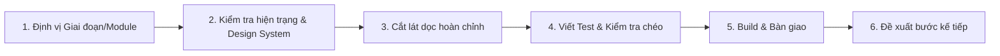

# Hướng Dẫn Phát Triển Hệ Thống Web Tool Booking KOL / KOC

> [!CAUTION]
> **QUY TẮC PHẠM VI GỬI MẪU:**
> 1. Không có module vận chuyển độc lập và không có tích hợp API hãng vận chuyển trong phạm vi hiện tại.
> 2. Campaign có chức năng ghi nhận từng đợt gửi mẫu trong `campaign_creator_sample_logs`, gồm sản phẩm/số lượng, thời điểm, địa chỉ snapshot, ghi chú và các trường tùy chọn `carrier_name`/`tracking_code`. Đây là nhật ký nội bộ; không tự tạo vận đơn, tra cứu tracking hay tính phí vận chuyển.
> 3. Quy trình Pipeline liên quan đến gửi mẫu hiện gồm:
>    - `address_confirmed`: KOC đã điền địa chỉ nhận hàng (qua Portal hoặc nhân viên lưu).
>    - `sample_sent`: Nhân viên xác nhận đã chuyển mẫu (`sample_sent_at`).
>    - `sample_received`: Đã nhận mẫu (`sample_received_at`), bắt đầu đếm ngược hạn nộp video.
> 4. Giữ nguyên chức năng nhật ký gửi mẫu hiện hữu. Mọi thay đổi về phạm vi giao nhận hoặc tích hợp ngoài hệ thống cần được người dùng yêu cầu rõ ràng.

> [!IMPORTANT]
> **Nguồn sự thật khi phát triển:** migrations, routes, enums, services, controllers và tests hiện có là mô tả chuẩn cho hành vi đang chạy. Các tài liệu trong `references/` có thể chứa mục tiêu/lộ trình cũ; không được dùng chúng để tự đổi nghiệp vụ. Khi phát hiện lệch, cập nhật tài liệu hoặc báo rõ điểm cần xác nhận trước khi đổi hành vi.

Skill này đóng vai trò là "kim chỉ nam" hướng dẫn phát triển (vibe coding) từng bước một ứng dụng Web chuyên dụng thay thế Excel và chat thủ công cho đội ngũ booking KOL/KOC nội bộ của doanh nghiệp.

---

## 1. Ngăn Xếp Công Nghệ Bắt Buộc (Tech Stack)

- **Backend**: Laravel 11 kết hợp kiến trúc mô-đun `nwidart/laravel-modules`.
- **Frontend**: React (TypeScript/JSX) + Inertia.js (SPA không cần viết REST API rời rạc).
- **Styling & Design System**: Tailwind CSS với tokens mở rộng, hỗ trợ tiếng Việt mượt mà.
- **Database & Cache**: ứng dụng hỗ trợ cấu hình MySQL/SQLite; queue và cache lấy theo cấu hình môi trường. Redis là lựa chọn kiến trúc phù hợp khi triển khai tải cao, không giả định đang bật nếu chưa kiểm tra `.env`/config.
- **Thư viện chuyên dụng**:
  - Kéo thả Kanban: `@dnd-kit/core`, `@dnd-kit/sortable`.
  - Biểu đồ Dashboard: `Recharts`.
  - Icon hệ thống: `lucide-react`.
  - Phân quyền: `spatie/laravel-permission`.
  - Xử lý Excel: `maatwebsite/excel`.
  - Kiểm thử: `Pest PHP` hoặc `PHPUnit`.

---

## 2. Tài Liệu Tham Chiếu Chuyên Sâu (Progressive Disclosure)

Khi thực hiện từng tác vụ cụ thể, chỉ đọc tài liệu tương ứng, **không đọc hết toàn bộ cùng lúc**:

- [Thuật ngữ nghiệp vụ (domain.md)](./references/domain.md): Phân hạng KOL/KOC (nano/micro/macro), rate card, air/lên video, affiliate, GMV, bom hàng, seeding.
- [Database (database.md)](./references/database.md): quy tắc dữ liệu và lược đồ tham chiếu; schema đang chạy được xác định bởi migrations.
- [Module (modules.md)](./references/modules.md): hiện có 7 Laravel modules `Creator`, `Campaign`, `Content`, `Outreach`, `Portal`, `Report`, `Settings`; Pipeline là chức năng thuộc Campaign, không phải module độc lập.
- [Quy chuẩn hệ thống thiết kế dùng chung (design-system.md)](./references/design-system.md): Bố cục khung `AppLayout`, hệ màu Enterprise SaaS B2B, typography tiếng Việt, Tailwind tokens và bộ Shared Components dùng chung.
- [Hướng dẫn thực thi giao diện nghiệp vụ (ui-guidelines.md)](./references/ui-guidelines.md): Ứng dụng Design System vào từng màn hình module: Kanban dnd-kit, bảng dữ liệu, form Inertia, biểu đồ Recharts, xử lý 5 trạng thái và ngôn ngữ tiếng Việt.
- [Quy tắc tích hợp & An toàn (integrations.md)](./references/integrations.md): Outreach deep-link/log hiện có, OA/ZNS là hướng tương lai chưa xác nhận trong code, an toàn kết nối và bảo vệ dữ liệu cá nhân.
- [Đồng bộ tự động & Thu thập dữ liệu (kol-automated-sync.skill.md)](../kol-automated-sync/SKILL.md): Pipeline tự động hóa 100% thu thập, đồng bộ chỉ số đa nền tảng qua Data Provider, Rate Limiting, Auto-Refresh Scheduler và KolDataAdapter.
- [Lộ trình 5 giai đoạn (phases.md)](./references/phases.md): GĐ1 (Nền tảng & Kanban) -> GĐ2 (Portal & Gửi Mẫu Tinh Gọn) -> GĐ3 (Zalo Outreach) -> GĐ4 (Collector & Metrics) -> GĐ5 (Báo cáo & ROI).
- [File dữ liệu mẫu (assets/import-creators-template.csv)](./assets/import-creators-template.csv): File CSV chuẩn mẫu để import Creator.

---

## 3. Quy Trình Làm Việc Bắt Buộc Của Claude (Workflow)

Mọi phản hồi và thao tác code của Claude phải tuân thủ nghiêm ngặt 6 bước sau:

1. **Định vị phạm vi**: Xác định task thuộc Giai đoạn nào (trong [phases.md](./references/phases.md)) và Module nào (trong [modules.md](./references/modules.md)). Chỉ đọc file reference liên quan trực tiếp.
2. **Kiểm tra hiện trạng kiến trúc & UI (Inspect First)**:
   - Trước khi viết giao diện, kiểm tra cấu trúc dự án, layout hiện có (`resources/js/Layouts`), `tailwind.config.js` và các Shared Components (`resources/js/Components`).
   - Ưu tiên tái sử dụng component sẵn có. Nếu dự án chưa có nền tảng Design System chuẩn, xây dựng bộ component dùng chung trước rồi mới phát triển màn hình nghiệp vụ.
3. **Phát triển theo lát cắt dọc nhỏ (Vertical Slice)**:
   - Một lượt làm việc chỉ giải quyết một lát cắt hoàn chỉnh chạy được ngay: `Migration -> Model & Quan hệ -> Service/Action -> Form Request & Policy -> Controller/Inertia -> Component React`.
   - **Tuyệt đối không** viết dở dang hoặc để mã giả/placeholder (như `// ...phần còn lại tương tự`). Code phải đầy đủ 100%.
4. **Kiểm tra tác động chéo & Test**:
   - Khi chỉnh sửa layout hoặc shared component, phải kiểm tra xem có ảnh hưởng tiêu cực đến các module đã xây dựng trước đó hay không.
   - Khi thay đổi logic, bổ sung/cập nhật test phù hợp với quy ước repository; chạy kiểm tra liên quan khi người dùng yêu cầu xác minh hoặc khi quy trình bàn giao yêu cầu. Ưu tiên các test lõi: gộp trùng, chuyển trạng thái, deadline, báo cáo và phân quyền.
5. **Kiểm tra bản build & Bàn giao**:
   - Chọn lệnh kiểm tra đúng phần bị ảnh hưởng; không mặc định build/test toàn bộ nếu không cần hoặc chưa được yêu cầu.
   - Kiểm tra hiển thị responsive (ưu tiên laptop 13"-16", mobile hỗ trợ xem dữ liệu và thao tác nhanh).
   - Nội dung bàn giao: Danh sách file tạo/sửa (kèm link), lệnh terminal cần chạy, hướng dẫn kiểm tra thủ công, rủi ro/lưu ý và 1 bước tiếp theo đề xuất.
6. **Xử lý yêu cầu mơ hồ**:
   - Nếu ảnh hưởng tới cấu trúc Database hoặc luồng nghiệp vụ: **Hỏi tối đa 3 câu ngắn** trước khi làm.
   - Nếu là chi tiết nhỏ (UI, label, màu sắc): **Tự chọn mặc định tối ưu nhất theo [design-system.md](./references/design-system.md)** và giải thích rõ trong phản hồi.

---

## 4. Quy Chuẩn Thiết Kế Giao Diện Thống Nhất (UI Consistency Rules)

Để tránh hiện tượng "mỗi trang một phong cách", mọi giao diện phải tuân thủ nghiêm ngặt 5 nguyên tắc sau:

1. **Kiến trúc Layout duy nhất (Unified Layout)**:
   - Các trang quản trị nên tái sử dụng `AppLayout` và component hiện có; Pipeline và gửi mẫu là chức năng trong Campaign. Kiểm tra implementation cụ thể trước khi kết luận trang nào đang dùng layout nào.
   - Tuyệt đối không tự tạo Blade layout riêng (`master.blade.php`) hay layout React riêng cho từng module.
   - Creator Portal (`/portal/{token}`) dùng layout tối giản dạng đơn cột cho di động, nhưng bắt buộc dùng chung Design Tokens và Shared Components.
2. **Hệ màu Enterprise SaaS B2B**:
   - Màu chủ đạo (Primary): `Indigo-600` (`#4f46e5`) - Hover `Indigo-700` (`#4338ca`) - Muted `Indigo-50` (`#eef2ff`).
   - Bề mặt: App Background `bg-slate-50`, Card/Table/Modal Surface `bg-white`, Border `border-slate-200`.
   - Màu trạng thái: `Success` (Emerald), `Warning` (Amber), `Danger` (Rose), `Info` (Blue). Tuyệt đối không hardcode mã màu lạ.
3. **Thư viện Thành phần Dùng chung (Shared Components)**:
   - Bắt buộc tái sử dụng các component chuẩn tại `resources/js/Components/`: `AppLayout`, `Sidebar`, `Topbar`, `PageHeader`, `Button`, `Badge`, `DataTable`, `FilterBar`, `FormField`, `Modal`, `Toast`, `EmptyState`, `LoadingSkeleton`, `ConfirmDialog`.
4. **Xử lý 5 Trạng Thái Giao Diện (States)**:
   - Mọi màn hình phải xử lý đủ: `Loading` (Skeleton nhấp nháy), `Empty` (EmptyState có nút kêu gọi), `Error` (lỗi form chữ đỏ, lỗi mạng có nút thử lại), `Success` (Toast tự tắt sau 4s), `Permission` (ẩn/disable nút khi thiếu quyền kèm tooltip).
5. **Ngôn ngữ 100% Tiếng Việt Chuẩn**:
   - Toàn bộ nhãn, nút bấm, thông báo toast và validate đều bằng tiếng Việt doanh nghiệp chuẩn mực. Định dạng tiền tệ `1.500.000 đ`, ngày tháng `DD/MM/YYYY`.

---

## 5. Nguyên Tắc An Toàn & Từ Chối Thao Tác Vi Phạm (Safety Guidelines)

Khi người dùng yêu cầu:
1. **Cào dữ liệu tự động hàng loạt từ TikTok/Facebook/Shopee**:
   - *Hành động*: Từ chối lịch sự phần cào lậu; nêu rõ rủi ro bị khóa IP/tài khoản.
   - *Giải pháp thay thế*: Đề xuất dùng file import Excel/CSV, dữ liệu xuất từ Kalodata/FastMoss, hoặc Chrome Extension "Lưu thủ công vào CRM".
2. **Spam tin nhắn tự động bằng tài khoản Zalo cá nhân**:
   - *Hành động*: Từ chối viết bot giả lập đăng nhập tự động tài khoản Zalo cá nhân (dễ bị khóa số vĩnh viễn).
   - *Giải pháp thay thế*: Đề xuất sử dụng Zalo OA/ZNS chính thức hoặc chế độ bán tự động (deep-link `zalo.me/<sđt>` kết hợp soạn sẵn nội dung).
3. **Bảo mật dữ liệu cá nhân (Nghị định 13/2023)**:
   - Số điện thoại và địa chỉ nhận hàng phải được che mờ (`091****789`) đối với vai trò không cần thiết; ghi log truy cập khi xem chi tiết hoặc export.

---

## 6. Quy Chuẩn Lập Trình (Code Conventions)

### 6.1. Backend Laravel
- **Enums**: Dùng PHP 8.1+ Enum cho các trạng thái (ví dụ: `PipelineStatusEnum`, `CreatorTierEnum`, `PlatformEnum`).
- **Validation**: Dùng Form Request cho luồng mới có validation phức tạp; repository hiện cũng có validation trực tiếp trong Controller. Khi sửa luồng cũ, giữ nguyên hành vi và chỉ tách validation khi có lợi ích rõ ràng, kèm kiểm tra tương ứng.
- **Service/Action Pattern**: Mọi nghiệp vụ phức tạp đặt trong `Modules/<ModuleName>/Services/` hoặc `Actions/`.
- **Chuẩn hóa dữ liệu**: Múi giờ hệ thống `Asia/Ho_Chi_Minh`. Tiền tệ hiển thị dạng `1.500.000 đ`. SĐT bắt buộc chuẩn hóa 10 số.

### 6.2. Frontend React + Inertia
- **Vị trí Component**: Trang chức năng đặt trong `resources/js/Pages/<ModuleName>/`, các component dùng chung đặt trong `resources/js/Components/` và `resources/js/Layouts/`.
- **Form**: Luôn sử dụng `useForm` của Inertia để tận dụng cơ chế xử lý lỗi và trạng thái `processing` hiển thị spinner.
- **Bảng**: Tìm kiếm debounce 300ms, filter và phân trang gửi qua `router.get` với `preserveState: true`.
