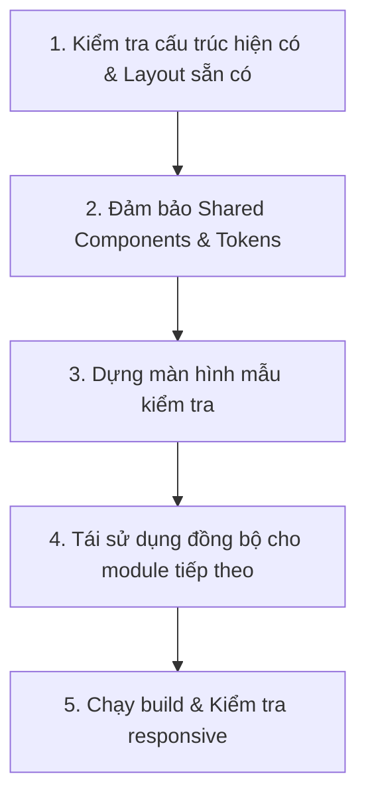

# Quy Chuẩn Hệ Thống Thiết Kế Giao Diện Dùng Chung (Design System)

> **Mục tiêu cốt lõi**: Đảm bảo toàn bộ 9 module của hệ thống Booking KOL/KOC (`Creator`, `Campaign`, `Pipeline`, `Outreach`, `Shipment`, `Content`, `Report`, `Portal`, `Settings`) sử dụng cùng một kiến trúc giao diện, cùng một bảng màu Enterprise SaaS hiện đại, cùng hệ thống Typography và chia sẻ 100% các thành phần dùng chung (Shared Components). Tuyệt đối không để xảy ra tình trạng phân mảnh layout hoặc mỗi module tự chế phong cách riêng.

---

## 1. Kiến Trúc Bố Cục Thống Nhất (Unified Layout Architecture)

Mọi trang chức năng trong hệ thống quản trị nội bộ **BẮT BUỘC** phải kế thừa từ một layout duy nhất: `AppLayout` (hoặc `AuthenticatedLayout` đã được chuẩn hóa).

### 1.1. Bố Cục Tiêu Chuẩn Cho 8 Module Quản Trị
```
+-------------------------------------------------------------------------------------+
| [Sidebar - Cố định bên trái] | [Topbar / Header - Sticky trên cùng]                 |
|  - Brand Logo & Name         |  - Nút toggle Sidebar (mobile & collapse mode)       |
|  - Menu nhóm điều hướng:     |  - Breadcrumb định vị vị trí trang hiện tại          |
|    + CRM & Creators          |  - Thanh tìm kiếm nhanh toàn hệ thống (Quick search) |
|    + Chiến dịch & Pipeline   |  - Chuông thông báo (Notification bell & popover)    |
|    + Vận hành & Gửi mẫu      |  - User Profile & Dropdown Đăng xuất                 |
|    + Nội dung & Duyệt video  |------------------------------------------------------|
|    + Báo cáo & Cài đặt       | [PageHeader - Tiêu đề & Thao tác chính]              |
|  - Thông tin user thu gọn    |  - Tiêu đề trang (H1) + Mô tả ngắn                   |
|                              |  - Action Buttons (Xuất Excel, Thêm mới, Bộ lọc...)  |
|                              |------------------------------------------------------|
|                              | [Main Content Area - Vùng nội dung nghiệp vụ]        |
|                              |  - Bảng dữ liệu / Kanban Board / Form / Dashboard    |
+-------------------------------------------------------------------------------------+
```

- **Sidebar (Menu trái)**: Rộng 260px trên Desktop (13" - 16"), cố định (sticky). Hỗ trợ chế độ thu gọn (collapsed icon-only 72px) và drawer trượt trên thiết bị di động/máy tính bảng.
- **Topbar (Thanh tiêu đề trên)**: Cao 64px (h-16), nền trắng bề mặt (`bg-white`), viền đáy mỏng `border-b border-slate-200`. Chứa Breadcrumb điều hướng và thông tin người dùng.
- **PageHeader**: Khối tiêu đề trang tiêu chuẩn, tách biệt rõ ràng giữa Tiêu đề (H1) + Mô tả ngữ cảnh và các Nút hành động chính (Primary Call-to-Action buttons) ở góc phải.
- **Main Content**: Nền êm dịu `bg-slate-50`, đệm cách lề chuẩn (`px-4 sm:px-6 lg:px-8 py-6`), thanh cuộn mượt mà.

### 1.2. Ngoại Lệ Duy Nhất: Cổng KOL / KOC Portal (`/p/{token}`)
- Màn hình dành cho Creator điền địa chỉ hoặc xác nhận nhận hàng/video qua thiết bị di động.
- **Bố cục tối giản (Minimalist Layout)**: Không có Sidebar và Header quản trị phức tạp.
- **Bắt buộc tuân thủ Design System**: Dù bố cục dạng Container đơn cột (Mobile-first max-w-lg), Portal **bắt buộc** phải sử dụng cùng Design Tokens: Font chữ tiếng Việt, bảng màu Brand Primary, FormField, Button, Alert và Card shadow như phần còn lại của ứng dụng.

---

## 2. Hệ Thống Màu Sắc Doanh Nghiệp (Enterprise Color Palette & Tokens)

Bảng màu được thiết kế theo phong cách B2B SaaS hiện đại: Tối giản, trang nhã, tương phản cao, dịu mắt khi thao tác liên tục 8 tiếng/ngày.

```
       [Primary Brand]            [Surface & Border]           [Neutral Text]
   Indigo-600: #4f46e5           White Surface: #ffffff      Slate-900: #0f172a (Head)
   Indigo-700: #4338ca           Slate-50: #f8fafc (App bg)  Slate-700: #334155 (Body)
   Indigo-50:  #eef2ff           Slate-200: #e2e8f0 (Border) Slate-500: #64748b (Muted)
```

### 2.1. Màu Thương Hiệu & Thao Tác (Brand & Primary)
Sử dụng dải màu `Indigo / Violet` thể hiện tính công nghệ, chuyên nghiệp và phong cách sáng tạo (Creator Economy):
- `primary-50` (`#eef2ff`): Nền badge nhẹ, nền menu item đang active, highlight hàng trong bảng.
- `primary-100` (`#e0e7ff`): Viền badge, hover nhẹ của button phụ.
- `primary-500` (`#6366f1`): Focus ring, đường viền active khi focus form.
- `primary-600` (`#4f46e5`): Màu nút chính (Primary Button), link nhấn mạnh, icon điểm nhấn.
- `primary-700` (`#4338ca`): Trạng thái Hover của nút chính.

### 2.2. Màu Nền, Bề Mặt & Đường Viền (Neutral Tokens)
- **App Background**: `bg-slate-50` (`#f8fafc`) - Tạo độ tương phản nhẹ với các khối thẻ trắng.
- **Surface / Card Background**: `bg-white` (`#ffffff`) - Dùng cho Card, Modal, Dropdown, Table container.
- **Muted Surface**: `bg-slate-100` (`#f1f5f9`) - Header của bảng (`<thead>`), thanh lọc, placeholder skeleton.
- **Border**: `border-slate-200` (`#e2e8f0`) - Đường viền mỏng tiêu chuẩn (1px) phân tách các khối.
- **Divider**: `divide-slate-200` cho danh sách và các hàng bảng.

### 2.3. Màu Chữ Phân Cấp (Text Hierarchy)
- **Tiêu đề & Chữ quan trọng**: `text-slate-900` (`#0f172a`), font-semibold / font-bold.
- **Nội dung chính (Body)**: `text-slate-700` (`#334155`), font-normal, tương phản đạt chuẩn WCAG AA.
- **Nhãn mô tả & Muted**: `text-slate-500` (`#64748b`), phụ đề, metadata, label form.
- **Placeholder & Disabled**: `text-slate-400` (`#94a3b8`), ô nhập liệu chưa điền hoặc nút bị khóa.

### 2.4. Màu Trạng Thái Nghiệp Vụ Chuẩn (Semantic Status Tokens)
Tuyệt đối không dùng mã hex tự do. Mọi trạng thái phải ánh xạ vào các cặp màu nền / chữ sau:

| Trạng thái | Nền (Background) | Viền (Border) | Chữ (Text) | Ý nghĩa nghiệp vụ |
| :--- | :--- | :--- | :--- | :--- |
| **Success** | `bg-emerald-50` | `border-emerald-200` | `text-emerald-700` | Đã lên video, Đã nhận mẫu, Hoàn tất, Import thành công |
| **Warning** | `bg-amber-50` | `border-amber-200` | `text-amber-700` | Sắp đến deadline (còn 2 ngày), Chờ Creator xác nhận, Chờ duyệt |
| **Danger** | `bg-rose-50` | `border-rose-200` | `text-rose-700` | Quá hạn deadline, Bom hàng, Blacklist, Lỗi hệ thống, Nút xóa |
| **Info** | `bg-blue-50` | `border-blue-200` | `text-blue-700` | Đã liên hệ, Đang vận chuyển, Tin nhắn mới, Mẹo hướng dẫn |
| **Neutral** | `bg-slate-100` | `border-slate-200` | `text-slate-700` | Hồ sơ mới, Bản nháp, Chưa kích hoạt |
| **Purple** | `bg-purple-50` | `border-purple-200` | `text-purple-700` | Phân hạng Macro/Mega Creator, Thao tác đặc biệt |

### 2.5. Ánh Xạ Trạng Thái Pipeline Cố Định (Pipeline Stage Colors)
Để tránh mỗi trang hiển thị một màu khác nhau, 8 trạng thái Pipeline thống nhất quy định:
- `Mới (New)`: `bg-slate-100 text-slate-700 border-slate-200`
- `Đã liên hệ (Contacted)`: `bg-blue-50 text-blue-700 border-blue-200`
- `Đồng ý / Chốt (Agreed)`: `bg-cyan-50 text-cyan-800 border-cyan-200`
- `Đã gửi mẫu (Sample Sent)`: `bg-indigo-50 text-indigo-700 border-indigo-200`
- `Đã nhận mẫu (Sample Received)`: `bg-purple-50 text-purple-700 border-purple-200`
- `Đã lên video (Posted)`: `bg-emerald-50 text-emerald-700 border-emerald-200`
- `Hoàn tất (Completed)`: `bg-green-100 text-green-900 border-green-300`
- `Từ chối (Declined)`: `bg-gray-100 text-gray-600 border-gray-200`
- `Bom hàng / Cảnh báo (Blacklist)`: `bg-rose-100 text-rose-800 border-rose-300 font-bold`

---

## 3. Typography, Spacing, Radius & Icons

### 3.1. Phông Chữ Tiếng Việt
- **Font Family**: Ưu tiên hệ font hiển thị tiếng Việt hoàn hảo, rõ dấu, không lỗi chân chữ:
  ```css
  font-family: 'Inter', 'Be Vietnam Pro', system-ui, -apple-system, BlinkMacSystemFont, 'Segoe UI', Roboto, sans-serif;
  ```
- **Thang kích thước font chuẩn**:
  - `Display / KPI Number`: `text-3xl` (30px) / `text-2xl` (24px), font-bold, `tracking-tight`.
  - `Page Title (H1)`: `text-xl` (20px) hoặc `text-2xl` (24px), font-bold, `text-slate-900`.
  - `Section / Modal Title (H2)`: `text-lg` (18px), font-semibold, `text-slate-900`.
  - `Card Header / Table Header`: `text-sm` (14px), font-medium / font-semibold, `text-slate-700`.
  - `Body / Input / Table Cell`: `text-sm` (14px), font-normal, line-height `leading-5`, `text-slate-700`.
  - `Caption / Badge / Helper Text`: `text-xs` (12px), font-medium, `leading-4`.

### 3.2. Quy Chuẩn Bo Góc (Border Radius) & Đổ Bóng (Shadow)
- **Border Radius**:
  - `rounded-lg` (8px): Nút bấm (`Button`), Ô nhập liệu (`Input`, `Select`), Huy hiệu (`Badge`).
  - `rounded-xl` (12px): Khối thẻ (`Card`), Bảng (`DataTable container`), Hộp thoại (`Modal`).
  - `rounded-full`: Avatar người dùng, Dot trạng thái, Pill tag tròn.
- **Shadow**:
  - `shadow-sm`: Thẻ bề mặt thông thường (Card, Table).
  - `shadow-md`: Dropdown menu, Popover, Autocomplete suggestions.
  - `shadow-lg` / `shadow-xl`: Modal dialog, Thẻ Kanban khi đang được nhấc kéo (`@dnd-kit`).

### 3.3. Hệ Thống Icon Đồng Bộ (`lucide-react`)
Sử dụng duy nhất thư viện `lucide-react` cho toàn bộ dự án:
- Kích thước trong Nút / Badge: `w-4 h-4` (16px), `stroke-width={2}`.
- Kích thước trong Menu Sidebar / Tiêu đề khối: `w-5 h-5` (20px).
- Kích thước trong Trạng thái rỗng (Empty State) / Icon cảnh báo Modal: `w-10 h-10` đến `w-12 h-12`.

---

## 4. Cấu Hình Tailwind Chuẩn (`tailwind.config.js`)

Mọi lập trình viên và trợ lý Claude phải mở rộng cấu hình `tailwind.config.js` để hỗ trợ hệ thống tokens, đảm bảo quét đủ file trong cả `resources/js` và các `Modules/*/resources/assets`:

```javascript
import defaultTheme from 'tailwindcss/defaultTheme';
import forms from '@tailwindcss/forms';

/** @type {import('tailwindcss').Config} */
export default {
    content: [
        './vendor/laravel/framework/src/Illuminate/Pagination/resources/views/*.blade.php',
        './storage/framework/views/*.php',
        './resources/views/**/*.blade.php',
        './resources/js/**/*.{tsx,ts,jsx,js}',
        './Modules/**/resources/views/**/*.blade.php',
        './Modules/**/resources/assets/js/**/*.{tsx,ts,jsx,js}',
    ],

    theme: {
        extend: {
            fontFamily: {
                sans: ['Inter', 'Be Vietnam Pro', ...defaultTheme.fontFamily.sans],
            },
            colors: {
                primary: {
                    50: '#eef2ff',
                    100: '#e0e7ff',
                    200: '#c7d2fe',
                    300: '#a5b4fc',
                    400: '#818cf8',
                    500: '#6366f1',
                    600: '#4f46e5',
                    700: '#4338ca',
                    800: '#3730a3',
                    900: '#312e81',
                },
            },
            boxShadow: {
                card: '0 1px 3px 0 rgb(0 0 0 / 0.05), 0 1px 2px -1px rgb(0 0 0 / 0.05)',
            },
        },
    },

    plugins: [forms],
};
```

---

## 5. Thư Viện Thành Phần Dùng Chung (Shared Components Library)

Tất cả thành phần sau phải nằm trong `resources/js/Components/` và `resources/js/Layouts/`. Khi phát triển bất kỳ module nào, **bắt buộc tái sử dụng**, tuyệt đối không code lại từ đầu.

```
resources/js/
├── Layouts/
│   ├── AppLayout.tsx         # Layout chính (Sidebar + Topbar + Content)
│   └── GuestLayout.tsx       # Layout cho trang Login / Portal KOL
└── Components/
    ├── Common/
    │   ├── PageHeader.tsx    # Header của từng trang (H1 + CTA)
    │   ├── Breadcrumb.tsx    # Thanh định vị vị trí
    │   ├── Button.tsx        # Nút đa biến thể, hỗ trợ spinner loading
    │   ├── Badge.tsx         # Huy hiệu trạng thái, phân hạng
    │   ├── EmptyState.tsx    # Giao diện khi chưa có dữ liệu
    │   ├── LoadingSkeleton.tsx # Khung xương tải trang
    │   ├── Toast.tsx         # Thông báo flash tự động tắt
    │   └── ConfirmDialog.tsx # Modal xác nhận thao tác nguy hiểm
    ├── Table/
    │   ├── DataTable.tsx     # Bảng dữ liệu chuẩn server-side
    │   └── FilterBar.tsx     # Thanh tìm kiếm debounce + Dropdown lọc
    ├── Form/
    │   ├── FormField.tsx     # Bọc nhãn, required '*', helper, error
    │   ├── TextInput.tsx     # Ô nhập văn bản chuẩn hóa
    │   ├── Select.tsx        # Dropdown lựa chọn
    │   └── Textarea.tsx      # Ô nhập văn bản dài
    └── Navigation/
        ├── Sidebar.tsx       # Cột menu trái phân nhóm
        └── Topbar.tsx        # Thanh điều hướng trên cùng
```

### 5.1. `AppLayout.tsx`
- Layout khung chuẩn bọc toàn bộ ứng dụng.
- Quản lý trạng thái mở/đóng Sidebar trên Mobile.
- Tự động hiển thị `Toast` khi nhận flash messages (`success`, `error`) từ Inertia props.

### 5.2. `PageHeader.tsx`
- Props:
  - `title: string` (Tiêu đề trang)
  - `description?: string` (Mô tả ngắn bên dưới)
  - `breadcrumbs?: { label: string; href?: string }[]`
  - `actions?: ReactNode` (Slot chứa các nút thao tác như Thêm mới, Xuất file...)

### 5.3. `Button.tsx`
- Hỗ trợ các biến thể màu sắc chuẩn:
  - `primary`: `bg-primary-600 hover:bg-primary-700 text-white shadow-sm`
  - `secondary`: `bg-white hover:bg-slate-50 text-slate-700 border border-slate-300`
  - `danger`: `bg-rose-600 hover:bg-rose-700 text-white`
  - `ghost`: `text-slate-600 hover:bg-slate-100`
- Kích thước: `sm` (px-2.5 py-1.5 text-xs), `md` (px-3.5 py-2 text-sm - mặc định), `lg` (px-4 py-2.5 text-base).
- Hỗ trợ prop `loading?: boolean`: Khi `true`, nút tự động disabled, ẩn icon và hiển thị vòng xoay spinner kèm chữ tiếng Việt (ví dụ: *"Đang lưu..."*).

### 5.4. `Badge.tsx`
- Props: `variant`: `'default' | 'primary' | 'success' | 'warning' | 'danger' | 'info' | 'purple'`, `size`: `'sm' | 'md'`, `dot?: boolean`.
- Tự động áp dụng cặp màu nền/chữ chuẩn semantic đã quy định ở Mục 2.4.

### 5.5. `DataTable.tsx` & `FilterBar.tsx`
- Chuẩn hóa giao diện hiển thị danh sách dạng bảng:
  - Bo góc `rounded-xl`, viền `border border-slate-200`, nền trắng có đổ bóng nhẹ `shadow-sm`.
  - Hàng tiêu đề `<thead>` nền xám nhạt `bg-slate-50 text-slate-500 font-semibold text-xs uppercase tracking-wider`.
  - Hàng dữ liệu `<tr>` có hiệu ứng `hover:bg-slate-50/80 transition-colors`.
  - Thanh phân trang gắn liền ở đáy bảng (Footer Pagination) hiển thị rõ: *"Hiển thị 1 đến 15 của 120 kết quả"*.
  - `FilterBar`: Ô tìm kiếm có debounce 300ms, icon kính lúp bên trái, các dropdown lọc, nút "Xóa bộ lọc" khi có ít nhất 1 filter đang kích hoạt.

### 5.6. `FormField.tsx`
- Component bọc ngoài cho mọi ô nhập liệu trong form:
  - Hiển thị nhãn (`label`), dấu hoa thị đỏ (`*`) nếu bắt buộc nhập.
  - Hiển thị thông báo lỗi validate màu đỏ (`text-rose-600 text-xs mt-1.5 flex items-center gap-1`).
  - Hiển thị văn bản hướng dẫn (`hint`) màu xám mờ nếu có.

### 5.7. `Modal.tsx` & `ConfirmDialog.tsx`
- Nền backdrop đen mờ có blur: `bg-slate-900/40 backdrop-blur-sm`.
- Container bo góc mềm mại `rounded-2xl bg-white shadow-2xl`, nút tắt [X] tinh tế ở góc phải trên.
- `ConfirmDialog`: Chuyên dùng cho các thao tác hủy bỏ/xóa/gộp hồ sơ, có icon cảnh báo tam giác vàng/đỏ, nút xác nhận màu `danger` kèm spinner loading khi đang xử lý.

### 5.8. `Toast.tsx`
- Xuất hiện nổi ở góc trên hoặc dưới bên phải màn hình.
- Tự động mờ dần và biến mất sau 4000ms (có thể đóng thủ công).
- Phân loại rõ ràng: Thành công (icon xanh), Lỗi (icon đỏ), Cảnh báo (icon vàng).

### 5.9. `EmptyState.tsx` & `LoadingSkeleton.tsx`
- **EmptyState**: Khi bảng lọc không có kết quả hoặc danh mục chưa có dữ liệu, hiển thị icon nét mảnh tao nhã `w-12 h-12 text-slate-400`, thông điệp rõ nghĩa và nút hành động giải cứu (ví dụ: *"Thêm Creator đầu tiên"* hoặc *"Đặt lại bộ lọc"*).
- **LoadingSkeleton**: Hiệu ứng nhấp nháy `animate-pulse bg-slate-200 rounded` mô phỏng chính xác khung bảng/card để giao diện không bị giật layout khi tải dữ liệu.

---

## 6. Quy Chuẩn Cho Các Màn Hình Nghiệp Vụ Đặc Thù

### 6.1. Bảng Kanban Kéo Thả (`Pipeline`)
- Sử dụng `@dnd-kit/core` và `@dnd-kit/sortable`.
- Chiều rộng cột cố định tối ưu: `w-80 shrink-0`.
- Đầu cột (Column Header): Tiêu đề in hoa nhẹ, badge đếm Creator tròn (`bg-slate-200 text-slate-700 text-xs font-bold px-2 py-0.5 rounded-full`), tổng tiền booking ước tính màu xám mờ bên cạnh.
- Thẻ Creator (Kanban Card):
  - Bo góc `rounded-lg border border-slate-200 bg-white p-3.5 shadow-sm hover:shadow-md transition-shadow`.
  - Hiệu ứng khi nhấc kéo: `opacity-90 shadow-xl scale-[1.02] rotate-1 cursor-grabbing`.
  - Huy hiệu hạn nộp video: Quá hạn màu đỏ rực (`bg-rose-100 text-rose-700 font-semibold`), còn dưới 2 ngày màu vàng cam (`bg-amber-100 text-amber-700`).

### 6.2. Biểu Mẫu Thêm Mới / Chỉnh Sửa (`Form Screens`)
- Bố cục 2 cột trên Desktop: Cột trái (65% chiều rộng) chứa các trường dữ liệu chính; Cột phải (35%) chứa thông tin tóm tắt, ảnh đại diện hoặc trạng thái.
- Sử dụng hook `useForm` của Inertia:
  - Nút Submit luôn đi kèm trạng thái `processing` (tự đổi text sang "Đang lưu..." và vô hiệu hóa click lặp).
  - Thanh nút bấm cuối form: Nút phụ "Hủy bỏ" (`variant="secondary"`) bên trái, nút chính "Lưu thay đổi" (`variant="primary"`) bên phải.

### 6.3. Báo Cáo & Biểu Đồ Dashboard (`Recharts`)
- **Khối chỉ số KPI (Metric Cards Grid)**: Lưới 4 cột trên laptop (`grid grid-cols-1 sm:grid-cols-2 lg:grid-cols-4 gap-4`).
  - Giá trị chỉ số to đậm (`text-2xl font-bold text-slate-900`).
  - Huy hiệu phần trăm so sánh tuần trước: Xanh lá (`text-emerald-700 bg-emerald-50`) nếu tăng trưởng, Đỏ (`text-rose-700 bg-rose-50`) nếu sụt giảm.
- **Biểu đồ Recharts**:
  - Bảng màu đường nét & cột đồ thị: Đồng bộ mã hex từ tokens:
    - Primary: `#4f46e5` (Doanh thu / GMV)
    - Emerald: `#10b981` (Tỷ lệ lên video / Thành công)
    - Amber: `#f59e0b` (Mẫu đã gửi)
    - Blue: `#0284c7` (Lượt tiếp cận mới)
    - Rose: `#e11d48` (Tỷ lệ bom hàng / Từ chối)
  - Tooltip biểu đồ: Bọc trong khung trắng `bg-white/95 backdrop-blur-sm border border-slate-200 rounded-lg shadow-lg p-2.5 text-xs`.

---

## 7. Khả Năng Thích Ứng (Responsive) & Đa Trạng Thái (States)

1. **Ưu tiên màn hình Laptop (13" - 16")**:
   - Đây là môi trường làm việc chính của nhân viên vận hành booking (độ phân giải 1366x768, 1440x900, 1920x1080).
   - Mật độ dữ liệu vừa vặn (Compact Data Density), thanh cuộn ngang chỉ xuất hiện bên trong bảng hoặc Kanban, không làm tràn toàn trang.
2. **Hỗ trợ Di động (Mobile-friendly)**:
   - Sidebar tự động ẩn vào nút Hamburger ở góc trái Topbar.
   - Bảng dữ liệu tự động cho phép cuộn ngang có chỉ báo bóng mờ (`overflow-x-auto`).
   - Các nút thao tác nhóm thành menu dropdown 3 chấm `...` nếu thiếu diện tích.
3. **Xử lý 5 trạng thái bắt buộc trên mọi màn hình**:
   - `Loading State`: Skeleton loader đồng nhất hình dạng.
   - `Empty State`: Thông điệp gợi mở và nút giải cứu.
   - `Error State`: Thông báo lỗi chi tiết bằng tiếng Việt, có nút "Thử lại".
   - `Success State`: Toast thông báo góc màn hình + cập nhật dữ liệu tức thì không reload trang.
   - `Permission State`: Ẩn hoặc disable các nút thao tác mà user không có quyền, kèm tooltip giải thích lý do.

---

## 8. Quy Trình 5 Bước Triển Khai Giao Diện Cho Claude

Trước khi viết hoặc chỉnh sửa bất kỳ giao diện nào trong dự án, Claude **BẮT BUỘC** thực hiện đúng 5 bước:



1. **Kiểm tra hiện trạng (Inspect First)**:
   - Đọc cấu trúc `resources/js/Layouts`, `resources/js/Components` và `tailwind.config.js`.
   - Tuyệt đối không tự ý đẻ thêm Blade Layout mới hoặc layout React riêng lẻ trong từng module.
2. **Xây dựng nền tảng trước (Foundation First)**:
   - Nếu dự án chưa có đủ shared components (`Button`, `Badge`, `DataTable`, `FormField`...), hãy tạo các shared components đó trước rồi mới phát triển màn hình nghiệp vụ.
3. **Lấy module Creator / Pipeline làm chuẩn mực**:
   - Dựng một màn hình hoàn chỉnh, kiểm tra các tương tác, trạng thái rỗng và màu sắc để đạt độ chuẩn mực.
4. **Kiểm tra tác động chéo (Cross-module Impact)**:
   - Khi chỉnh sửa bất kỳ component dùng chung nào trong `resources/js/Components/`, phải kiểm tra xem các module đã làm trước đó có bị vỡ giao diện hay không.
5. **Nghiệm thu bản build (Build Verification)**:
   - Luôn chạy lệnh `npm run build` sau khi code xong giao diện để đảm bảo không có lỗi TypeScript, thiếu import hay cú pháp Tailwind hỏng trước khi bàn giao cho người dùng.
